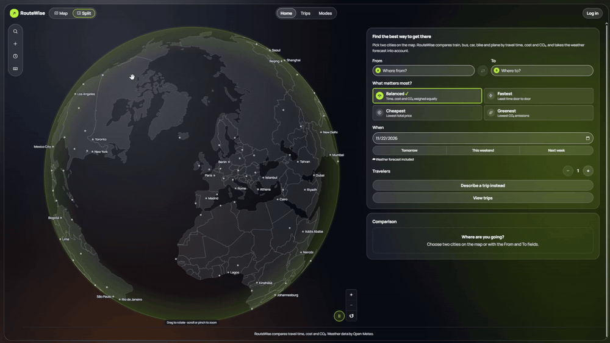
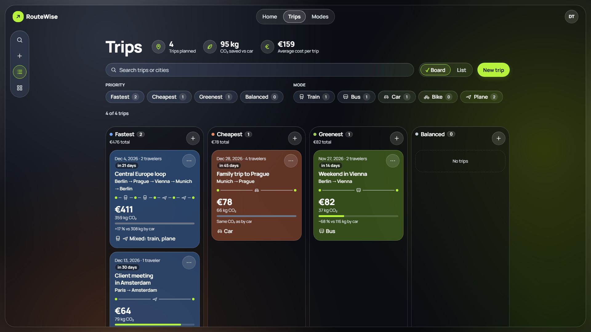
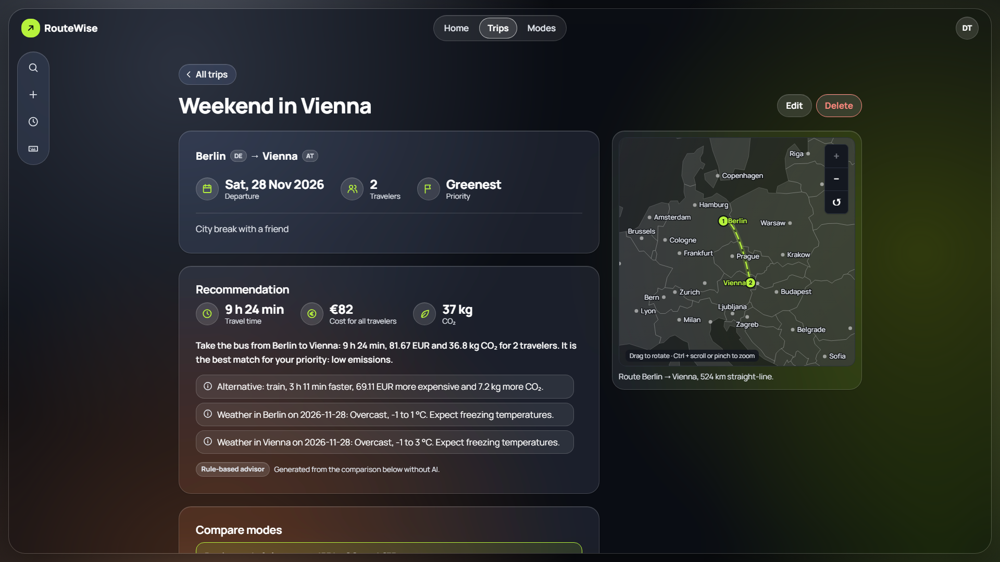
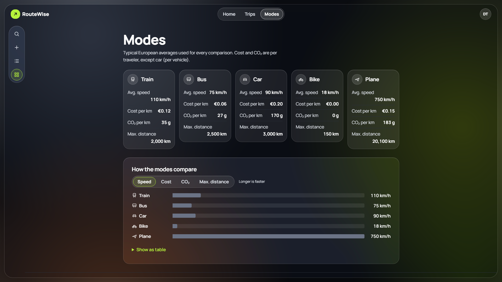

# RouteWise

Multimodal trip planner that compares train, bus, car, bike and plane by travel time, cost and CO₂ emissions, leg by leg,
with the weather forecast taken into account and an AI travel advisor that explains the recommendation.



- **Plan:** [docs/PLAN.md](docs/PLAN.md) · **Key decisions:** [docs/DECISIONS.md](docs/DECISIONS.md#key-decisions) · **AI workflow log:** [docs/AI_WORKFLOW.md](docs/AI_WORKFLOW.md)

## Demo

https://github.com/user-attachments/assets/e34f0275-c0e7-4730-b6d0-537878ed7d0a

Full walkthrough with voice-over: [docs/demo/routewise-demo.mp4](docs/demo/routewise-demo.mp4)

## Features

- **Instant comparison on a globe**: pick two cities on an interactive SVG globe (or in searchable pickers) and see time, cost,
  CO₂ and a 0–100 score for every mode, without saving anything. The route state lives in the URL.
- **Priorities**: fastest, cheapest, greenest or balanced; the priority weights the score.
- **Multi-stop trips**: 2–10 stops; every leg is compared on its own and the best mode per leg forms a mixed itinerary,
  compared with using one mode for the whole trip.
- **Weather-aware**: Open-Meteo forecasts for today and the next 15 days; rain, snow, wind or ice lower the bike's (and in snow
  the car's and bus's) score, with a note.
- **Realistic availability**: ground modes only between cities joined by land, within each mode's range; flights with separate
  short- and long-haul CO₂ factors; 422 cities on every continent.
- **AI travel advisor**: free text such as *"Berlin to Vienna next Friday, 2 people, cheap"* becomes a draft trip, and each trip's
  recommendation is explained leg by leg. Uses Claude when `ANTHROPIC_API_KEY` is set and built-in rules otherwise.
- **Accounts and private trips**: email and password with a server-side session; one-click demo account with sample trips.
- **Trips page**: server-side search, filters with counts, sorting, pagination, KPIs (CO₂ saved against driving, average cost,
  next trip), a board by priority with drag and drop, a list with inline details, duplicate, and delete with Undo.
- **Accessible glass UI**: keyboard support throughout, WCAG AA contrast checked over the translucent surfaces, reduced motion
  and reduced transparency respected.

| Trips board | Multi-stop trip details | Modes |
|---|---|---|
|  |  |  |

## Quick start

**Requirements:** Java 21 and a current Node.js LTS (developed with Node 24). No database, API key or other configuration is
needed; Maven is downloaded by the wrapper.

```bash
# Terminal 1: API on http://localhost:8087
cd backend && ./mvnw spring-boot:run

# Terminal 2: UI on http://localhost:4200
cd frontend && npm install && npm start
```

Open http://localhost:4200 and click **Try the demo** on the login page, or log in with the demo account:

| Email | Password |
|---|---|
| `demo@routewise.app` | `demo1234` |

The demo account comes with four sample trips, including a multi-stop loop through Berlin, Prague, Vienna and Munich. You can
also create your own account; trips are private to the account that saved them. The database is in memory, so every restart
begins with only the demo account and its sample trips.

| Tool | URL |
|---|---|
| UI | http://localhost:4200 |
| API documentation (Swagger UI) | http://localhost:8087/swagger-ui.html |
| OpenAPI JSON | http://localhost:8087/v3/api-docs |
| Health check | http://localhost:8087/actuator/health |
| H2 console | http://localhost:8087/h2-console (JDBC URL `jdbc:h2:mem:routewise`, user `sa`, empty password) |

### Configuration (optional)

Every setting has a default; environment variables override them.

| Variable | Default | Purpose |
|---|---|---|
| `ANTHROPIC_API_KEY` | none | Enables the Claude advisor; without it, rule-based parsing and advice are used |
| `ROUTEWISE_ADVISOR_MODEL` | `claude-opus-5-5` | Claude model for the advisor |
| `ROUTEWISE_DEMO_ENABLED` | `true` | Set to `false` to skip the demo account (do this for any real deployment) |
| `ROUTEWISE_SESSION_TIMEOUT` | `2h` | How long a login lasts without activity |
| `ROUTEWISE_TRIPS_RESTORE_WINDOW` | `30s` | How long a deleted trip can be restored |
| `ROUTEWISE_WEATHER_CACHE_TTL` | `1h` | How long a forecast is reused per city and date |
| `ROUTEWISE_CORS_ALLOWED_ORIGINS` | `http://localhost:4200` | Origins allowed to call the API |
| `SERVER_PORT` | `8087` | API port |

## How it works

For each leg, the API takes the great-circle distance between the cities times a detour factor per mode, checks whether the mode
is available (same landmass for ground modes, within the mode's range), computes time, cost and CO₂ from the seeded mode
parameters, normalises the three metrics among the available modes, weights them by the priority (0.6 for the main goal, 0.2 for
the others, a third each for balanced), adjusts for the weather and recommends the best score. The legs combine into the mixed
itinerary. The AI advisor only words the explanation; the recommendation always comes from this engine, and Claude's output is
validated like user input.

## Architecture

```
Angular SPA (:4200) ──JSON, session cookie, CSRF header──▶ Spring Boot API (:8087) ──▶ H2 in memory (schema by Flyway)
                                                              ├──▶ Open-Meteo (weather; cached, retried, optional)
                                                              └──▶ Claude (advisor; only with an API key)
```

| | Backend (`backend/`) | Frontend (`frontend/`) |
|---|---|---|
| Stack | Java 21, Spring Boot 4.1, Spring Security, Spring Data JPA, Flyway, H2, springdoc-openapi, Caffeine, Anthropic Java SDK | Angular 22 (standalone components, signals, zoneless), TypeScript, SCSS, RxJS, `d3-geo` |
| Structure | Package by feature (`trip`, `comparison`, `weather`, `advisor`, `user`, `city`, `transportmode`, `demo`), each layered `controller → service → repository` | `core/api` (typed API services), `core/auth`, `shared/ui` (building blocks), `shared/map` (globe), `features/*` (pages) |
| Principles | DTOs as records, pure business rules, external clients behind interfaces, RFC 7807 Problem Details, layering enforced by ArchUnit | Smart pages and presentational components, all HTTP through `core/api`, one error type (`ApiError`), no UI library |
| Conventions | [backend/CLAUDE.md](backend/CLAUDE.md) | [frontend/CLAUDE.md](frontend/CLAUDE.md) |

### API overview

Public: `GET /api/cities`, `GET /api/transport-modes`, `POST /api/comparisons`, `/api/auth/*`, `GET /actuator/health`.
Everything else needs a login; another user's trip answers 404. Full details in Swagger UI.

| Method | Path | Purpose |
|---|---|---|
| POST | `/api/auth/register`, `/api/auth/login`, `/api/auth/logout`; GET `/api/auth/me` | Accounts and session |
| GET | `/api/trips` | Search, filter, sort and page your trips, with figures and filter counts |
| GET | `/api/trips/stats` | KPIs over your trips |
| GET / POST / PUT / DELETE | `/api/trips`, `/api/trips/{id}` | Trip CRUD (delete is a soft delete) |
| POST | `/api/trips/{id}/restore` | Undo a delete within the restore window |
| GET | `/api/trips/{id}/comparison` | Per-leg, weather-aware comparison of a saved trip |
| POST | `/api/comparisons` | Compare a route without saving it |
| GET | `/api/trips/{id}/advice` | AI or rule-based explanation of the recommendation |
| POST | `/api/advisor/parse` | Free text → trip draft |
| GET | `/api/cities`, `/api/transport-modes` | Reference data |

## Testing

| What | Command | Notes |
|---|---|---|
| Backend build and all tests | `cd backend && ./mvnw verify` | Unit, web-slice, JPA (real Flyway schema), migration, integration and ArchUnit tests (460); external services are faked |
| Frontend unit tests | `cd frontend && npm test` | Vitest + TestBed, 748 tests |
| Frontend lint | `cd frontend && npm run lint` | ESLint with angular-eslint, including template accessibility rules |
| End-to-end checks | `cd frontend && npm run e2e` | Playwright against the running app (starts `npm start` if port 4200 is free) |
| Screenshots | `cd frontend && npm run screenshots` | Playwright captures every screen at 1920, 1280 and 375 px (needs the app running) |

## Project structure

```
backend/     Spring Boot REST API (Java 21, Maven)
frontend/    Angular SPA (TypeScript, standalone components)
docs/        PLAN.md (scope, API, milestones), DECISIONS.md, AI_WORKFLOW.md, demo/, screenshots/
.claude/     Claude Code agents, skills, hooks and permissions
```

## Data & assumptions

RouteWise gives estimates for comparing options, not quotes or timetables.

- **Cities:** 422 cities on every continent (capitals, major hubs, at least
  two per US state), seeded by Flyway migrations (`V2`, `V7`, `V11`; flight
  factors in `V8`; Moscow removed again in `V10`). Coordinates are city centres.
  Names are unique worldwide, so a shared name means one city (Portland is
  Oregon, Kingston is Jamaica).
- **Distance:** great-circle (haversine) distance between the cities, times a
  detour factor per mode (train 1.2; bus, car and bike 1.3; plane 1.0).
- **Prices:** one cost per kilometre per mode, used worldwide. These are rough
  global estimates; real fares vary widely by country, season and operator.
- **Ground modes and landmasses:** train, bus, car and bike are only offered
  when both cities are on the same *landmass*, a region joined by land, and the
  route is within the mode's maximum distance. Fixed links count: the Channel
  Tunnel and the Øresund and Great Belt bridges make Great Britain and the
  Danish islands part of Eurasia. Ferries do not: Ireland, Iceland, Japan,
  Australia, New Zealand and other islands are separate landmasses. Africa is
  treated as separate from Eurasia. Otherwise the mode is shown as unavailable
  with a reason (`DIFFERENT_LANDMASS` or `TOO_FAR`).
- **Flight CO₂:** two factors per passenger-km from the UK DEFRA greenhouse
  gas conversion factors 2023 (economy class, including radiative forcing):
  short-haul 183 g up to 3,700 km great-circle distance (DEFRA's short/long-haul
  boundary), long-haul 200 g above it. The factor depends on the leg's distance.
  The values are still to be checked against the official DESNZ spreadsheet.
- **Other CO₂ and speeds:** typical European averages per mode (car per
  vehicle, shared by up to five travellers; others per traveller).
- **Weather:** Open-Meteo forecasts for today and the next 15 days, cached per
  city and date for an hour (`ROUTEWISE_WEATHER_CACHE_TTL`). A failed call is
  retried once; if the forecast is still missing the comparison works without
  it and says so (`weatherStatus`).
- **Trip list and KPIs:** the figures on the Trips page (cost, CO₂, CO₂ against
  the car, average cost, CO₂ saved) are computed **without weather**, so the
  list needs no external call. For a trip in the next two weeks the details
  page, which does use the weather, can recommend another mode (e.g. no bike in
  rain).
- **Deleted trips** can be restored for 30 seconds (`ROUTEWISE_TRIPS_RESTORE_WINDOW`).
- **Map:** land and borders from Natural Earth 1:110m (public domain).

## Known limitations

- The database is in memory: data is reset on every restart.
- Prices and emission factors are estimates (see above); there are no timetables or bookings.
- The advisor endpoints have no rate limit or cost guard; set a key only for trusted use.
- The UI reads the CSRF cookie in JavaScript, so UI and API must share a host (use a reverse proxy when deploying them apart).
- The Claude integration is tested against a local fake of the Messages API, not with live calls.

## Built with Claude Code

RouteWise was built milestone by milestone with [Claude Code](https://claude.com/claude-code) as a pair programmer, under
written rules and with a human deciding scope, dependencies and design:

- **Rules:** [CLAUDE.md](CLAUDE.md), [backend/CLAUDE.md](backend/CLAUDE.md), [frontend/CLAUDE.md](frontend/CLAUDE.md).
- **Plan first:** every feature is a milestone in [docs/PLAN.md](docs/PLAN.md), approved before any code; decisions and
  their reasons are logged in [docs/DECISIONS.md](docs/DECISIONS.md).
- **Review and tests:** sub-agents in [.claude/agents](.claude/agents) (`backend-reviewer`, `ui-reviewer`, `test-writer`,
  `ui-builder`), workflow skills in [.claude/skills](.claude/skills), and hooks that block edits to applied migrations and `.env`
  files.
- **Honest log:** [docs/AI_WORKFLOW.md](docs/AI_WORKFLOW.md) records, per milestone, what was delegated to the AI, what the
  human decided and found, what the AI corrected itself, and why.

## Project docs

- [Key decisions](docs/DECISIONS.md#key-decisions): the architecture, security, data and AI decisions
  and why they were made; the full log is below them.
- [Plan](docs/PLAN.md): scope, domain model, API and milestones.
- [AI workflow](docs/AI_WORKFLOW.md): how the project was built with Claude Code, per milestone: what
  was delegated, what the human decided and found, and what the AI corrected itself.
